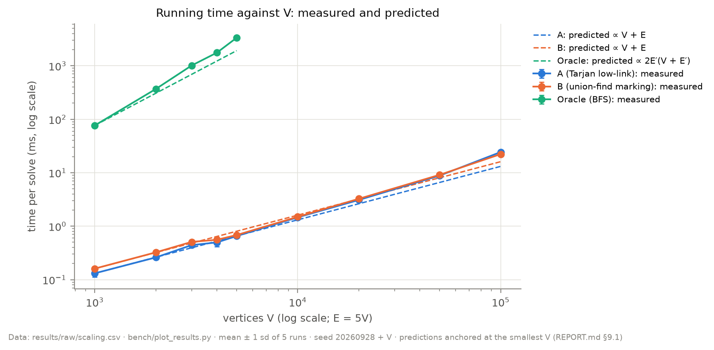
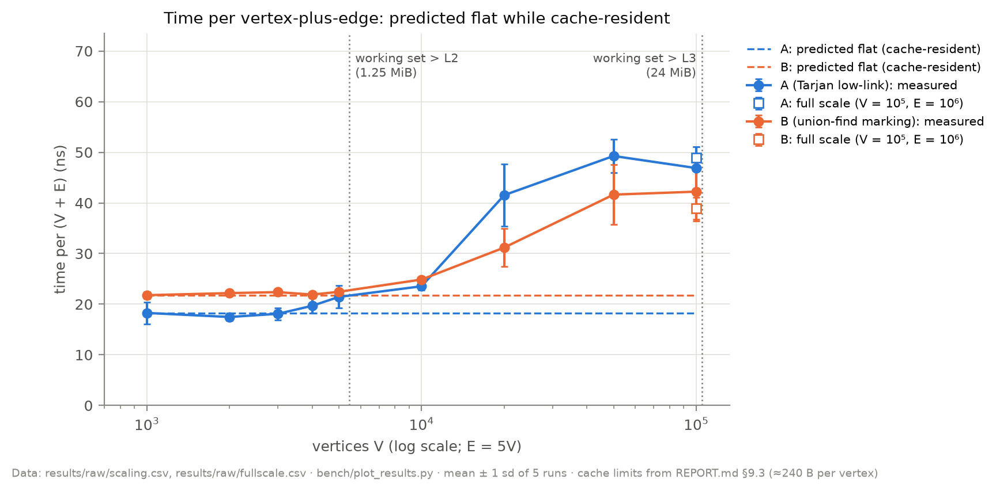
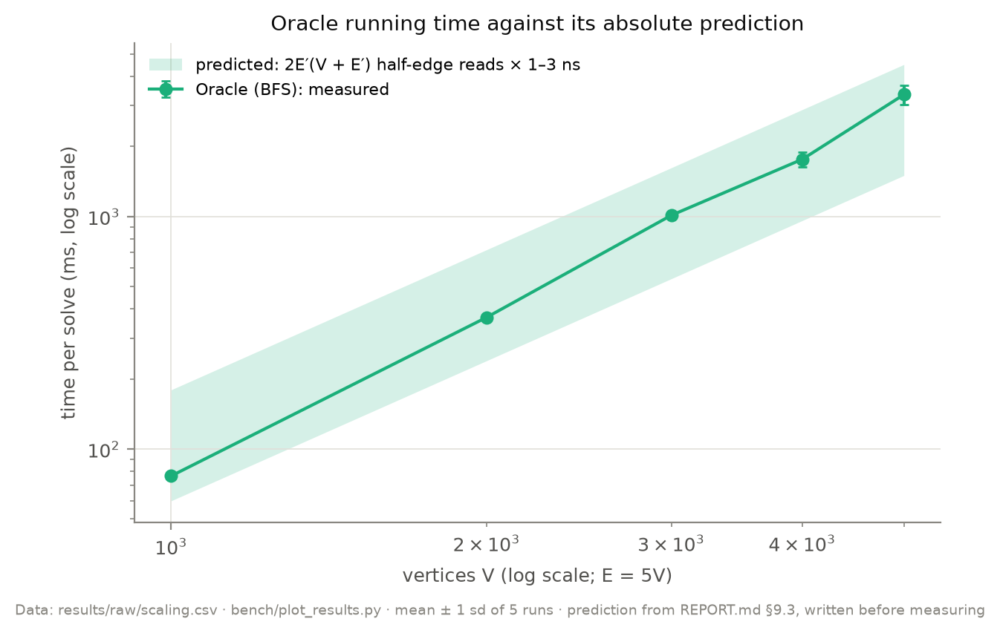
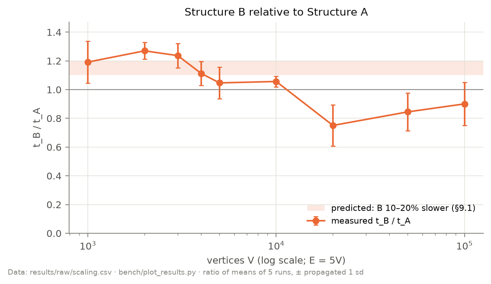
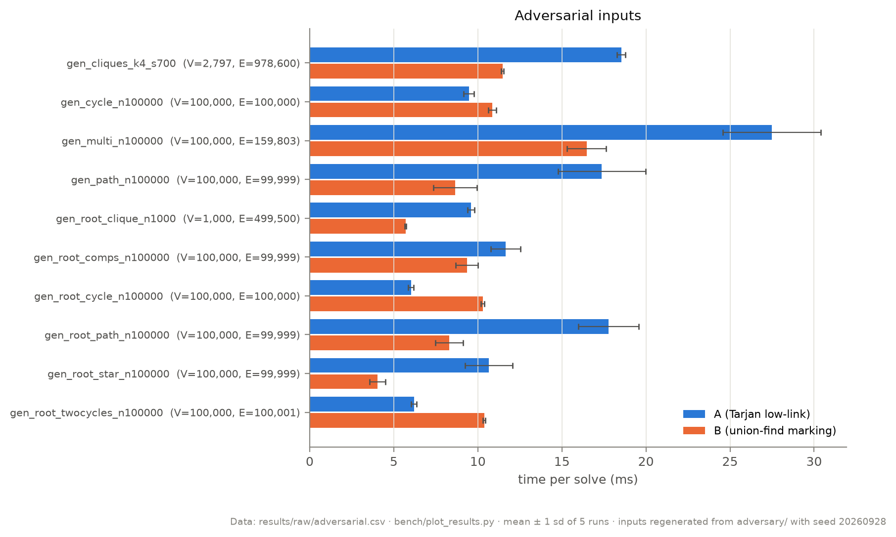
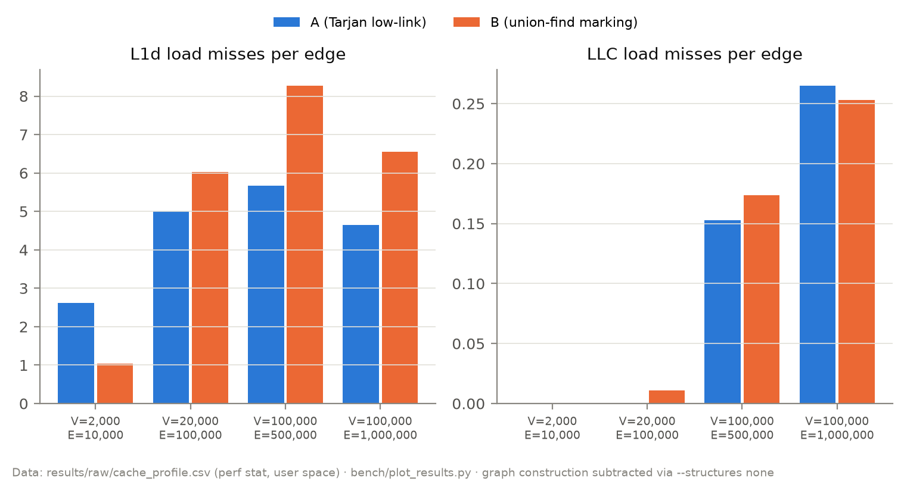

# Project 04: Critical Nodes and Links in a Network: Report

Team Oops · CS 253 / MA 253 · cs253-oops-p04

<!--
HOW TO FILL THIS REPORT (delete this comment before the final tag)
- Each section starts with a "TO FILL" box naming its owner. Write only in your own sections.
- Replace the box with your text when you are done. Keep the section and sub-section headings.
- Write in your own words. Text from a paper, website or AI tool must be quoted and cited (guidelines 4.4),
  and AI use must also be declared in TOOLS.md.
- Give numbers with units, and sizes as exact values or powers of ten.
- Work on a branch, commit with the prefix "report:", and open a PR. Deadline: Sunday 15 Nov, 20:00.
- Before the final tag, `grep -n "TO FILL" REPORT.md` must print nothing.
Target length: 12-20 pages, excluding appendices. Derivations are separate PDFs and do not count.
-->

## 1. Team and contributions

| Name | Roll no. | GitHub | Role | Module folder | Derivation |
|------|----------|--------|------|---------------|------------|
| Chetna Mundra | 250001024 | @cse250001024 | Structure A owner | `src/structA/` | D1 |
| Mayank Gupta | 250001047 | @cse250001047-MG | Structure B owner | `src/structB/` | D2 |
| Sufiyan Ahmad | 250001068 | @Sufiyan-cse-250001068 | Architect | `app/` | D3 |
| Shubham Sharma | 250051017 | @ep250051017-shubham | Oracle owner | `oracle/` | D4 |
| Raunak Kumar Singh | 250001060 | @cse250001060-collab | Adversary | `adversary/` | D5 |
| Deepak Chahar | 250001026 | @cse250001026 | Analyst | `bench/` | D6 |

> **TO FILL: every member, in your own row below** · ½ page in total
> Three or four bullets on what you built, each linked to the commit or PR that added it. The PRs already merged are listed for you; add any that follow.

**Chetna Mundra (Structure A):** PRs [#9](https://github.com/cse250001026/cs253-oops-p04/pull/9), [#14](https://github.com/cse250001026/cs253-oops-p04/pull/14), [#17](https://github.com/cse250001026/cs253-oops-p04/pull/17).
- …

**Mayank Gupta (Structure B):** PRs [#8](https://github.com/cse250001026/cs253-oops-p04/pull/8), [#10](https://github.com/cse250001026/cs253-oops-p04/pull/10), [#12](https://github.com/cse250001026/cs253-oops-p04/pull/12).
- Iterative DFS forest construction (`DFSForest.cpp`) with explicit heap stack and edge index pointers, preventing call stack overflow on deep paths up to $V = 100,000$ ([#8](https://github.com/cse250001026/cs253-oops-p04/pull/8)).
- Custom Disjoint Set Union (`DSU.cpp`) with two-pass path compression, union-by-rank, and `highest[]` depth tracking to preserve $O(\alpha(V))$ set operations while accessing shallowest path vertices ([#10](https://github.com/cse250001026/cs253-oops-p04/pull/10)).
- Fundamental cycle path marking (`makeCyclePath.cpp`), ID-ordered bridge extraction, and 2-ECC component grouping (`union_find_bridges.cpp`) ([#8](https://github.com/cse250001026/cs253-oops-p04/pull/8), [#12](https://github.com/cse250001026/cs253-oops-p04/pull/12)).
- Operation counter instrumentation matching analytical cost models (`BENCH_*`), invariant test harness (`tests/test_structB.cpp`), and D2 derivation document.

**Sufiyan Ahmad (Architect):** PRs [#2](https://github.com/cse250001026/cs253-oops-p04/pull/2), [#5](https://github.com/cse250001026/cs253-oops-p04/pull/5).
- …

**Shubham Sharma (Oracle):** PRs [#4](https://github.com/cse250001026/cs253-oops-p04/pull/4), [#7](https://github.com/cse250001026/cs253-oops-p04/pull/7), [#13](https://github.com/cse250001026/cs253-oops-p04/pull/13).
- …

**Raunak Kumar Singh (Adversary):** PR [#16](https://github.com/cse250001026/cs253-oops-p04/pull/16), and the generators PR (merge [`7e9c107`](https://github.com/cse250001026/cs253-oops-p04/commit/7e9c107)).
- …

**Deepak Chahar (Analyst):** PRs [#1](https://github.com/cse250001026/cs253-oops-p04/pull/1), [#6](https://github.com/cse250001026/cs253-oops-p04/pull/6), [#19](https://github.com/cse250001026/cs253-oops-p04/pull/19), [#20](https://github.com/cse250001026/cs253-oops-p04/pull/20), [#21](https://github.com/cse250001026/cs253-oops-p04/pull/21), [#25](https://github.com/cse250001026/cs253-oops-p04/pull/25) and the c3 results PR.
- The predicted-cost model (§9, D6), written before measuring: a first draft at c1 ([`d6d6456`](https://github.com/cse250001026/cs253-oops-p04/commit/d6d6456)) and the final model with exact operation-counter predictions ([`5ff34df`](https://github.com/cse250001026/cs253-oops-p04/commit/5ff34df)), committed before any file in `results/raw/`.
- The benchmark harness ([#19](https://github.com/cse250001026/cs253-oops-p04/pull/19)): `bench/bench.cpp` (timing, agreement checks against A and the oracle, the oracle's work cap), `bench/counters.hpp` (operation counters compiled out of timing builds, [#6](https://github.com/cse250001026/cs253-oops-p04/pull/6)), `bench/run_benchmarks.sh`, `bench/cache_profile.sh`, `bench/plot_results.py` and `scripts/run_all.sh`; and the `Makefile` ([#20](https://github.com/cse250001026/cs253-oops-p04/pull/20)).
- The measurements and figures in `results/` ([#21](https://github.com/cse250001026/cs253-oops-p04/pull/21), [#25](https://github.com/cse250001026/cs253-oops-p04/pull/25), tag c3), including the fix to the cache profile's per-solve count ([`034301c`](https://github.com/cse250001026/cs253-oops-p04/commit/034301c), bug 11), and the results in §11.
- Reviews of teammates' PRs against the project specification, the bug log (§7.4), the report skeleton and §2 ([`e2deacf`](https://github.com/cse250001026/cs253-oops-p04/commit/e2deacf)), and the README.

## 2. Problem

A network is an undirected graph of nodes and links, and we want to know where it is fragile. A node is
**critical** (an *articulation point*) if removing it splits the network into more connected pieces than
before. A link is critical (a *bridge*) if removing it does the same. The graph also splits into
*biconnected components*: the largest groups of links in which any two links lie on a common cycle, so no single node failure
separates them. A bridge forms a component of its own.

The project must compute all three for a network of 100,000 nodes, and support two uses on top of them:

- **A robustness report** that ranks the critical nodes by how many connected pieces the network falls
  into when each one fails.
- **A query service** that answers "if node v fails, is x cut off from y?". It uses a *block-cut tree*
  built from the biconnected components, and answers each query from DFS entry and exit times on that tree.

Two independent methods must find the same bridges. Structure A uses Tarjan's low-link DFS and also produces
the articulation points and biconnected components. Structure B marks cycle edges on a DFS tree, using
union-find to skip edges already marked. A brute-force oracle removes each node and each link in turn and counts
the pieces by BFS. Both structures must agree with it exactly on every graph small enough for it
(up to about 5,000 nodes).

**Scale.** We worked at the course's full scale for graph projects, 10^5 vertices and 10^6 edges, and
measured A, B and the oracle for V from 10^3 to 10^5. At this size, three things make the problem harder
than the textbook version:

- **Recursion depth.** A recursive DFS overflows the call stack on a path of 10^5 vertices, so both
  structures must be iterative.
- **The DFS root.** The root needs its own rule, and leaving it out gives wrong answers only on particular
  graphs.
- **Messy inputs.** The graphs may contain parallel links, self-loops, isolated nodes and several
  disconnected parts, and every module must handle each case in the same way.

## 3. Interface and invariants

> **TO FILL: Sufiyan** · 1 page
> Taken from INTERFACE.md, not copied wholesale. Summarise:
> - the shared `Graph` (vertices 0…V−1, edges with IDs, adjacency of (vertex, edge ID) pairs, self-loops stored but kept out of the adjacency lists) and the rules for parallel edges, self-loops, isolated vertices and disconnected graphs;
> - the four APIs: `TarjanSolver::solve`, `UnionFindBridgeSolver::solve`, `BfsOracle::solve` and the block-cut tree, with what each result holds and in what order;
> - every structural invariant the checkers test (INTERFACE.md §3), each with the file and function that checks it;
> - the input formats: the generator graph format and the `run_ops` format.

### 3.1 Common interface

### 3.2 Structural invariants

| Invariant | Holds for | Checked by (file, function) |
|-----------|-----------|-----------------------------|
| | | |

## 4. Structure A: iterative Tarjan low-link DFS

> **TO FILL: Chetna** · 2–3 pages
> Code: `src/structA/tarjan_lowlink.hpp`, `TarjanSolver::solve` (calls `runStructA`).

### 4.1 Representation
> The arrays kept (`tin`, `low`, `parent`, `parentEdge`, `next`, `separated`, the explicit DFS stack, the edge stack), what each stores, and the memory used.

### 4.2 Operations and their complexity
> | Step | What it does | Cost |
> |------|--------------|------|
> | Iterative DFS with `next[u]` | … | O(V + E) |
> | Bridges: `low[u] > tin[p]` | … | |
> | BCCs by popping the edge stack | … | |
> | Articulation points: `pieces = separated[v] + (parent[v] != -1)` | … | |
> | `components_after_removal` | … | |

### 4.3 Invariants maintained
> What holds on the stack and in `low[]` at each step, and why every edge is pushed onto the edge stack exactly once.

### 4.4 Design decisions and rejected alternatives
> | Decision | Alternative rejected | Why |
> |----------|----------------------|-----|
> | Explicit stack | Recursive DFS | Overflows on a 10^5-vertex path |
> | Skip the parent by edge ID | Skip by parent vertex | … (parallel edges) |
> | One formula for root and non-root | Separate root test | … |
> | | | |

## 5. Structure B: bridges by union-find path marking

Structure B computes the bridges and 2-edge-connected components (2-ECCs) of an undirected graph using an iterative Depth-First Search (DFS) spanning forest combined with a custom Disjoint Set Union (DSU) path-marking mechanism. The core theoretical premise is that an edge in an undirected graph is a bridge if and only if it does not lie on any simple cycle. In a DFS spanning forest, non-tree edges are exclusively back-edges between an ancestor and a descendant, each forming a fundamental cycle with the vertical tree path between its endpoints. By marking all tree edges on these fundamental cycles and contracting already-marked paths via union-find, unmarked tree edges are identified as bridges in $O((V + E)\,\alpha(V))$ total time.

The implementation is modularly structured across four translation units in `src/structB/`:
- `DFSForest.hpp` / `DFSForest.cpp`: Iterative DFS spanning forest construction (`buildDFSForest`).
- `DSU.hpp` / `DSU.cpp`: Disjoint Set Union with path compression, union-by-rank, and minimum-depth metadata tracking (`find`, `unite`, `get_highest`).
- `makeCyclePath.hpp` / `makeCyclePath.cpp`: Cycle path marking along vertical tree paths (`markCyclePath`).
- `union_find_bridges.hpp` / `union_find_bridges.cpp`: Bridge detection and 2-ECC grouping coordinator (`UnionFindBridgeSolver::solve`).

### 5.1 Representation

Structure B uses contiguous, cache-friendly flat arrays (`vector<int>` and `vector<bool>`) avoiding any heap reallocations during graph traversal and set operations.

1. **DFS Forest Arrays (`DFSForest` in `src/structB/DFSForest.hpp`)**:
   - `parent` (`vector<int>`, size $V$): Stores the immediate tree parent of each vertex $v$ in the DFS forest. Initialized to $-1$; DFS roots retain $-1$.
   - `depth` (`vector<int>`, size $V$): Stores the unweighted distance (hop count) from the root of $v$'s DFS tree to $v$. Roots have depth $0$. Used to orient non-tree edges vertically and terminate path marking.
   - `parentEdge` (`vector<int>`, size $V$): Stores the unique edge ID $e \in [0, E-1]$ connecting $v$ to $\text{parent}[v]$. Roots store $-1$. This enables $O(1)$ edge identification without scanning adjacency lists.
   - `isTreeEdge` (`vector<bool>`, size $E$): A boolean bitset marking whether edge ID $e$ is a tree edge ($e \in E_T$) or a non-tree edge ($e \in E \setminus E_T$).

2. **Cycle Path Marking Disjoint Set Union (`DSU` in `src/structB/DSU.hpp`)**:
   - `rep` (`vector<int>`, size $V$): The parent pointer for DSU trees, flattened during `find(v)` via two-pass path compression.
   - `rank` (`vector<int>`, size $V$): The rank (upper bound on tree height) of each set representative, incremented only when uniting two sets of equal rank (union-by-rank).
   - `highest` (`vector<int>`, size $V$): Auxiliary metadata array storing the vertex of strictly minimum DFS depth in the equivalence class of root $r$:
     $$\text{highest}[r] = \arg\min_{w \in \text{Set}(r)} \text{depth}[w]$$
     This field allows union-by-rank to choose the root arbitrarily while always preserving immediate access to the shallowest vertex in the contracted component via `get_highest(v) = highest[find(v)]`.

3. **Cycle Edge Marker (`marked` in `src/structB/union_find_bridges.cpp`)**:
   - `marked` (`vector<bool>`, size $E$): Boolean array initialized to `false`. An edge $e$ is marked `true` when it is traversed during cycle path ascent. An edge is a bridge if and only if `isTreeEdge[e] && !marked[e]`.

4. **Second Disjoint Set Union for 2-ECC Grouping (`ecc_dsu` in `src/structB/union_find_bridges.cpp`)**:
   - A distinct instance of `DSU` initialized with size $V$, used after bridge identification to contract all non-bridge, non-self-loop edges and partition $V$ into 2-edge-connected components.

**Memory Footprint.** Across the entire execution on $V = 100,000$ and $E = 1,000,000$:
- DFS forest: $3 \times 4\text{ B} \times V + E / 8\text{ B} \approx 1.2\text{ MB} + 125\text{ KB} \approx 1.33\text{ MB}$.
- Marking DSU: $3 \times 4\text{ B} \times V \approx 1.2\text{ MB}$.
- Markers & stack: $E / 8\text{ B} + 4\text{ B} \times V \approx 125\text{ KB} + 400\text{ KB} \approx 0.53\text{ MB}$.
- 2-ECC DSU: $3 \times 4\text{ B} \times V \approx 1.2\text{ MB}$ (allocated after marking).
Total auxiliary memory is under $4.5\text{ MB}$, well within typical L3 CPU cache capacities.

### 5.2 Operations and their complexity

The solver executes in four distinct sequential steps:

| Step | What it does | Implementation | Cost |
|------|--------------|----------------|------|
| **1. Build DFS Forest** | Explores all components using an explicit heap-allocated vector stack `st` and per-vertex adjacency edge index pointers `edge_idx[v]`. Records `parent`, `depth`, `parentEdge`, and sets `isTreeEdge[id] = true` for tree edges. | `buildDFSForest(g)` in `DFSForest.cpp` | $O(V + E)$ |
| **2. Mark Cycle Paths** | Scans all $E$ edges. For each non-tree edge $e = (u, v)$ ($u \neq v$), calls `markCyclePath`. Ascends the tree path from the deeper endpoint to the shallower endpoint using `dsu.get_highest(v)` to jump over already-contracted cycles, setting `marked[parentEdge[x]] = true` and uniting $x$ with $\text{parent}[x]$. | `markCyclePath(...)` in `makeCyclePath.cpp` | $O((V + E)\,\alpha(V))$ |
| **3. Collect Bridges** | Iterates over all edge IDs $0 \dots E-1$. An edge is collected into `result.bridge_ids` and `result.bridges` iff `isTreeEdge[id] && !marked[id]`. Emitted in increasing ID order. | Loop 4 in `union_find_bridges.cpp` | $O(E)$ |
| **4. Group 2-ECCs** | Initializes `ecc_dsu(V)`. Unites endpoints of all non-bridge, non-loop edges. Groups vertices into `result.two_eccs` in a single pass over $0 \dots V-1$, preserving sorted vertex order and canonical component ordering. | Loop 5 in `union_find_bridges.cpp` | $O((V + E)\,\alpha(V))$ |
| **Total** | Full bridge detection and 2-edge-connected component decomposition. | `UnionFindBridgeSolver::solve(g)` | $\mathbf{O((V + E)\,\alpha(V))}$ |

#### Detailed Complexity Breakdown of Path Marking
1. **At most $V - C - b$ `unite` calls:** Each call to `dsu.unite(x, p, depth)` merges two previously distinct components along an unmarked tree edge. Because the DFS forest contains exactly $V - C$ tree edges (where $C$ is the number of connected components) and each bridge is never united, the inner loop marks and unites an edge at most $V - C - b \le V - 1$ times across the entire algorithm.
2. **At most $2(V + E)$ `find` calls:** In `markCyclePath`, each while-loop step evaluates `dsu.get_highest(v)` (one `find`). If $\text{depth}[x] > \text{depth}[u]$, a tree edge is marked and `dsu.unite(x, p, depth)` is invoked (two `find`s inside `unite`). If $\text{depth}[x] \le \text{depth}[u]$, the loop terminates. The terminating check happens at most once per non-tree edge ($\le E$ times). Thus, the total number of `find` operations across all non-tree edges is bounded by $3(V - C - b) + E = O(V + E)$.
3. **Amortized Bound:** By Tarjan's Theorem (1975), any sequence of $m'$ operations on $n$ elements using union-by-rank and two-pass path compression runs in $O(m' \alpha(n))$ time. Setting $m' = O(V + E)$ and $n = V$ yields $O((V + E)\,\alpha(V))$ total time. Since $\alpha(V) \le 4$ for all practical inputs ($V \le 10^{80}$), this behaves as strictly linear time in practice.

### 5.3 Invariants maintained

The correctness of Structure B rests upon three invariant properties maintained throughout the algorithm:

1. **Cycle Contraction Invariant (2-ECC Subgraphs)**:
   At any point during the execution of `markCyclePath`, every disjoint set in `dsu` corresponds to a connected subgraph of vertices in the DFS forest connected entirely by tree edges that have already been marked on at least one cycle. All vertices within the same DSU set are mutually 2-edge-connected in the subgraph of examined edges.

2. **Minimum Depth Invariant (`highest`)**:
   For every valid root $r = \text{find}(w)$ of a DSU component, $\text{highest}[r]$ strictly points to the vertex with the minimum DFS depth in that component:
   $$\text{depth}[\text{highest}[r]] = \min_{v \in \text{Set}(r)} \text{depth}[v]$$
   - *Base Case:* Initially, each vertex $v$ forms its own singleton set with $\text{highest}[v] = v$, where $\text{depth}[v]$ is trivially minimal.
   - *Inductive Step:* When `unite(u, v, depth)` merges sets with roots $r_u$ and $r_v$, the winner root $r_{\text{new}}$ is chosen by rank. Regardless of which root wins, the algorithm explicitly sets:
     $$\text{highest}[r_{\text{new}}] = \begin{cases} \text{highest}[r_u] & \text{if } \text{depth}[\text{highest}[r_u]] < \text{depth}[\text{highest}[r_v]] \\ \text{highest}[r_v] & \text{otherwise} \end{cases}$$
     Since $\text{parent}[x]$ always has depth $\text{depth}[x] - 1$, depth tracking is strictly monotonically decreasing as the path ascends.

3. **Single Traversal and Jump Invariant**:
   Whenever a tree edge $e = (x, \text{parent}[x])$ is marked, $x$ is immediately united with $\text{parent}[x]$. For any subsequent non-tree edge whose fundamental cycle contains $x$, `dsu.get_highest(x)` jumps directly to $\text{parent}[x]$ or one of its ancestors in $O(\alpha(V))$ time, bypassing $e$. Thus, no tree edge is ever examined, marked, or united more than once.

4. **Bridge and Partition Invariants (INTERFACE.md §3, checked in `tests/test_structB.cpp`)**:
   - *Bridge Equivalence:* $\text{structB.bridge\_ids} == \text{structA.bridge\_ids}$ on all inputs up to $V = 100,000$.
   - *2-ECC Partition:* `two_eccs` forms a complete disjoint partition of $\{0, 1, \dots, V-1\}$ with $\sum |C_i| = V$, each component sorted ascending, ordered by minimum vertex ID.
   - *Bridge Crossing Invariant:* Every bridge connects two distinct 2-ECCs ($comp[u] \neq comp[v]$).
   - *Non-Bridge Invariant:* Every non-bridge, non-self-loop edge connects vertices within the same 2-ECC ($comp[u] == comp[v]$).
   - *Reachability Equivalence:* Connected components in $G \setminus \text{Bridges}$ match `two_eccs` identically.

### 5.4 Design decisions and rejected alternatives

| Decision | Alternative rejected | Why |
|----------|----------------------|-----|
| **`highest[]` metadata with union-by-rank** | Linking directly to the parent's set (`rep[x] = find(parent[x])`) | Directly setting `rep[x] = parent[x]` forces tree edges to point upward, which prevents union-by-rank. Without union-by-rank, path compression alone degrades worst-case find operations to $O(\log V)$ amortized (or $O(V)$ without full compression), failing the project's $O((V+E)\alpha(V))$ complexity requirement (bug log entry 4). Decoupling the DSU root choice (governed by `rank`) from the shallowest vertex (tracked by `highest[]`) achieves true $O(\alpha(V))$ amortized complexity while allowing instantaneous jumps to the path top. |
| **Iterative DFS with explicit stack and adjacency pointers** | Recursive DFS (`void dfs(u)`) | On long path graphs ($V = 100,000$), recursion stack depth reaches $10^5$ frames ($\approx 3.2\text{ MB}$ to $8\text{ MB}$ of stack memory), exceeding typical thread stack limits ($2\text{ MB}$ on Windows/Linux) and triggering `SIGSEGV` segmentation faults. The iterative implementation maintains an explicit heap `vector<int> st` and a `vector<int> edge_idx` cursor array, safely scaling to $V = 100,000$ and $E = 1,000,000$. |
| **Preserving `bridges` in sequential `bridge_ids` order** | Sorting `bridges` by endpoint pairs using `Edge::operator<` | `Edge::operator<` sorts by $(u, v)$ lexicographically. If bridge edge IDs are not monotonic with endpoint order (e.g. edge 0 = (2,3), edge 1 = (0,1)), sorting `bridges` caused `bridges[i] != g.edges[bridge_ids[i]]`, failing invariant checks and disagreeing with Structure A in 1,218 out of 5,000 random graphs (bug log entry 7). Emitting bridges directly in loop order $0 \dots E-1$ guarantees that `bridges` and `bridge_ids` remain 1-to-1 synchronized. |
| **Early self-loop filtering in DFS and path marking** | Allowing self-loops into adjacency lists or path marking | Self-loops ($u = v$) do not affect connectivity and can never be bridges. `Graph::add_edge` excludes them from `adj[][]`, and `markCyclePath` explicitly skips $u = v$, avoiding wasted DSU operations and ensuring $E' = E - L$ bounds are strictly observed. |
| **Independent second DSU pass for 2-ECC grouping** | Contracting bridges on the path-marking DSU | Attempting to reuse the cycle-marking DSU to produce 2-ECCs requires rolling back or re-routing components. A dedicated second pass over non-bridge edges with `ecc_dsu` runs in just $O((V+E)\alpha(V))$ and provides an isolated, deterministic, and canonically ordered partition. |

## 6. The requirement beyond the lecture

### 6.1 Bridges by union-find path marking

#### Theoretical Foundation: Tarjan (1974) and Tarjan (1975)
In his 1974 paper, *"A note on finding the bridges of a graph"* [3], Robert E. Tarjan demonstrated that bridge detection can be formulated as fundamental cycle detection on a spanning tree combined with disjoint-set path compression. When a depth-first search explores an undirected graph $G = (V, E)$, it partitions edges into a spanning forest $F = (V, E_T)$ and a set of back-edges $E \setminus E_T$, each connecting an ancestor $u$ and descendant $v$ in $F$.

Every back-edge $(u, v)$ induces a unique *fundamental cycle* consisting of the back-edge itself and the vertical tree path $P_T(u, v)$ in $F$. A fundamental graph-theoretic property is that an edge $e \in E$ is a bridge if and only if $e$ does not lie on any simple cycle. Because every cycle in $G$ can be expressed as a symmetric difference of fundamental cycles, an edge is a bridge if and only if it is a tree edge that does not belong to any fundamental cycle.

Tarjan observed that rather than computing lowpoint values recursively as in his 1972 linear-time algorithm [1], one can iteratively traverse and mark the tree path $P_T(u, v)$ for each back-edge $(u, v)$, while using a disjoint-set union (union-find) data structure to contract already-traversed paths. Once a tree edge is marked, its endpoints are united into an equivalence class. When subsequent back-edges traverse the tree, the union-find structure allows the algorithm to skip directly over already-contracted segments in amortized near-constant time.

In his companion 1975 paper, *"Efficiency of a good but not linear set union algorithm"* [4], Tarjan established the tight theoretical complexity of the disjoint-set union data structure. He proved that an intermixed sequence of $m'$ `find` and `unite` operations on $n$ elements using both path compression and union-by-rank (or union-by-size) requires at most $O(m' \alpha(m', n))$ time, where $\alpha$ is the functional inverse of Ackermann's function. Since the path-marking algorithm performs at most $V - 1$ unions (each unmarked tree edge is united at most once) and at most $O(V + E)$ finds (each non-tree back-edge incurs at most one non-uniting find before terminating), the total execution time of path marking is strictly bounded by $O((V + E) \alpha(V))$.

#### Implementation: `markCyclePath`
The cycle path marking mechanism is implemented in `markCyclePath` (`src/structB/makeCyclePath.cpp`). Given a non-tree edge $(u, v)$ with $\text{depth}[u] < \text{depth}[v]$:
1. The search begins at the deeper endpoint $v$. The algorithm queries `curr = dsu.get_highest(v)`, which performs `find(v)` with two-pass path compression to retrieve the root representative, followed by indexing `highest[root]` to obtain the vertex of strictly minimum DFS depth in $v$'s equivalence class.
2. While $\text{depth}[curr] > \text{depth}[u]$:
   - The immediate tree parent of $curr$ is retrieved via $p = \text{forest.parent}[curr]$.
   - The tree edge connecting $curr$ and $p$ is marked as belonging to a cycle: `marked[forest.parentEdge[curr]] = true`.
   - The sets containing $curr$ and $p$ are united via `dsu.unite(curr, p, forest.depth)`.
   - The algorithm advances up the tree: `curr = dsu.get_highest(curr)`.
3. As soon as $\text{depth}[curr] \le \text{depth}[u]$, the path has ascended to or above the shallow ancestor $u$. All tree edges on the fundamental cycle are now marked, and the loop terminates.

Because each unmarked tree edge is traversed and contracted at most once, and each edge is examined at most once per non-tree edge, the work amortizes to $O((V + E) \alpha(V))$. Tree edges that remain unmarked after all non-tree edges are processed are collected as bridges in a single $O(E)$ pass.

#### Differences from Tarjan's Original Paper
Structure B departs from Tarjan's original 1974 formulation in three key design aspects:

1. **Decoupling Rank from Depth (`highest[]` Metadata vs. Naive Parent Pointers)**:
   In Tarjan (1974), the representative of a contracted set was proposed to be the root-ward (shallowest) vertex by simply pointing the representative of the descendant set to the ancestor representative (`rep[v] = rep[p]`). While conceptually straightforward, forcing tree edges to always point upward strictly forbids union-by-rank. Without rank balancing, path compression alone yields an amortized complexity of $O(\log V)$ per operation on pathological inputs (or $O(V)$ in non-compressed variants), violating the required $O((V + E)\alpha(V))$ bound (recorded in Bug Log entry 4).
   Structure B resolves this tension by strictly decoupling the DSU tree balance from the DFS tree geometry:
   - Set roots and parent pointers in `rep[]` are merged purely according to `rank[]` (union-by-rank), preserving Tarjan's (1975) inverse Ackermann bound.
   - An independent metadata array `highest[r]` tracks the vertex with minimal `depth` across all members of root $r$'s equivalence class. During `unite(u, v, depth)`, `highest` for the winning root is assigned the endpoint with minimum DFS depth.
   This guarantees both balanced DSU trees ($O(\alpha(V))$ amortized operations) and instantaneous jumping to the highest ancestor in the contracted component via `get_highest(v) = highest[find(v)]`.

2. **Iterative Heap Stack vs. Recursive Traversal**:
   Tarjan (1974) assumed a standard recursive DFS traversal. On deep graphs such as long path graphs ($V = 100,000$), call-frame overhead causes stack memory exhaustion and segmentation faults on systems with standard $2\text{ MB}$ stack limits. Structure B implements an explicit heap-allocated vector stack `vector<int> st` and per-vertex adjacency cursor pointers `edge_idx` (`DFSForest.cpp`), supporting arbitrary graph topologies up to $V = 100,000$ safely.

3. **Multi-Phase Architecture vs. Interleaved Traversal**:
   Tarjan's paper describes path marking online during DFS backtracking. Structure B decouples the computation into distinct sequential phases:
   - *Phase 1:* Spanning forest construction (`buildDFSForest`).
   - *Phase 2:* Batch path marking over non-tree edges (`markCyclePath`).
   - *Phase 3:* Bridge collection preserving original edge ID ordering ($0 \dots E-1$).
   - *Phase 4:* Partitioning into 2-edge-connected components via an independent DSU instance (`ecc_dsu`).
   This separation guarantees that edge ID ordering is strictly preserved (avoiding discrepancy with Structure A's bridge order, bug log entry 7), keeps each algorithmic phase testable in isolation, and allows direct hardware cache profiling without entangled state.

### 6.2 Block-cut tree and the separation query

> **TO FILL: Sufiyan** · about ½–1 page
> What the reading says (Harary, Graph Theory, ch. 3), how the block-cut tree is built from Structure A's BCCs, how entry and exit times answer "does v separate x from y" (including when x or y is itself an articulation point), and where your implementation differs.

## 7. Correctness

### 7.1 The oracle and why it is correct

> **TO FILL: Shubham** · about ½ page
> `oracle/bfs_oracle.hpp`, `BfsOracle::solve`: remove each vertex and each non-loop edge in turn and count components by BFS. Why this is correct by definition (D4), why edges are removed by ID (parallel edges), why the test is "more than C0" components and not "more than 1", and its cost: O((V + E)^2), since it also removes every edge.

### 7.2 Differential test

> **TO FILL: Shubham** · about ½ page
> `oracle/differential_test.cpp`: what one operation is, the graph sizes, the seed (20260928), the result at 10^5 and 10^6 operations, and how a failure is shrunk to a minimal edge sequence (`oracle/failure_shrinker.cpp`).

### 7.3 Invariant checkers

> **TO FILL: Shubham** · about ½ page
> Each checker and what it tests: `tests/test_structA.cpp` (`verifyBccInvariants`), `tests/test_structB.cpp` (`verifyStructBInvariants`), `tests/oracle_tests.cpp`. Say how they are run (`make test`) and whether the differential test calls them.

### 7.4 Bug log

Built from every commit in the repository (all branches as of 15 Nov 2026: 83 commits, 58 of them non-merge), the pull-request
reviews, and the review notes kept during the project. "Found" is the date the bug was first seen; each fixed bug
links to the commit that fixed it. Where the evidence doesn't show how a bug was found, the entry says so and the
owner should confirm.

#### Fixed

| # | Found | Module | Symptom | How found | Fixed in |
|---|-------|--------|---------|-----------|----------|
| 1 | 2026-10-17 | oracle | Link error: `count_components` was defined in a header without `inline` or an include guard, so any program including `oracle/brute_force.hpp` from two `.cpp` files failed with "multiple definition of count_components". Introduced in [`144a453`](https://github.com/cse250001026/cs253-oops-p04/commit/144a453). | Review; confirmed by compiling two translation units that include the header. | [`429b862`](https://github.com/cse250001026/cs253-oops-p04/commit/429b862) (2026-10-17): moved into `class BfsOracle` with guard `BFS_ORACLE_HPP`; member functions defined in the class are implicitly `inline`. |
| 2 | 2026-10-17 | oracle | Edge deletion did nothing: `count_comp(g, delNode, delEdge, …)` never used `delEdge` (`-Wextra` reported it unused), so a "removed" edge was still traversed, removing an edge could never raise the component count, and no bridge would ever have been reported. The first draft also named the removed edge by its endpoint pair, which cannot tell two parallel edges apart. Introduced in [`144a453`](https://github.com/cse250001026/cs253-oops-p04/commit/144a453), carried into [`429b862`](https://github.com/cse250001026/cs253-oops-p04/commit/429b862). | Review, helped by the `-Wextra` unused-parameter warning. No wrong answer was ever produced, because the fix landed with the first bridge loop. | [`217f6bf`](https://github.com/cse250001026/cs253-oops-p04/commit/217f6bf) (2026-10-18): the BFS skips the edge by ID (`e.id == delEdge`), so deleting one parallel copy leaves the other. |
| 3 | 2026-10-18 | oracle | Performance: `count_comp` took `vis` and `que` **by value**, copying two O(V) arrays on each of its 1 + V + E′ calls and reallocating `vis` inside. Introduced in [`429b862`](https://github.com/cse250001026/cs253-oops-p04/commit/429b862). | Code review *(Shubham to confirm)*. | [`217f6bf`](https://github.com/cse250001026/cs253-oops-p04/commit/217f6bf) (2026-10-18): pass by reference; reset with `fill`. |
| 4 | 2026-10-28 | structB | Complexity: the DSU had path compression only, and path marking linked sets directly (`dsu.rep[x] = dsu.find(parent[x])`). The code therefore did not achieve the O((V + E) α(V)) bound that D2 must prove, only O(log V) amortised per find. Union by rank cannot simply be added, because the marking loop needs each set's root to be its shallowest vertex. | Review of PR `struct2` against the D2 bound. | [`6c7fb89`](https://github.com/cse250001026/cs253-oops-p04/commit/6c7fb89) added union by rank to `DSU::unite`, which path marking still bypassed; [`ebc8b0e`](https://github.com/cse250001026/cs253-oops-p04/commit/ebc8b0e) (2026-10-29) completed the fix: `highest[]` stores each set's shallowest vertex, and marking calls `get_highest()` and `unite(x, parent[x], depth)`. |
| 5 | 2026-10-28 | structB | Test that could never fail: `src/structB/test_structB.cpp` only printed bridges and 2-ECCs, asserted nothing, and compiled only with `-DSTRUCTB_STANDALONE`, so a broken Structure B would still exit 0. | Review of PR `struct2`; re-checked 2026-11-09. | [`014f4f5`](https://github.com/cse250001026/cs253-oops-p04/commit/014f4f5) (2026-11-09): replaced by `tests/test_structB.cpp`, which asserts fixed cases, agreement with A and the oracle, the 2-ECC partition and bridge invariants, and runs 10^5-vertex stress tests. |
| 6 | 2026-11-01 | structA | Interface mismatch: Structure A exposed a free function `runStructA()` with include guard `STRUCT_A_HPP`, but INTERFACE.md §2.1 defines `class TarjanSolver { static StructAResult solve(const Graph&); }` with guard `TARJAN_LOWLINK_HPP`. Any caller written to the spec (application, differential test, benchmark harness) failed to compile with "'TarjanSolver' has not been declared". The code reached main in this state through PR #9 (2026-11-02). The algorithm itself was correct. | Review of `feat/structA` against INTERFACE.md; confirmed 2026-11-06 by compiling a program written only from INTERFACE.md. | [`3c71398`](https://github.com/cse250001026/cs253-oops-p04/commit/3c71398) (2026-11-10, PR #14): added `TarjanSolver::solve` (calling `runStructA`, which the tests keep using) and renamed the guard. |
| 7 | 2026-11-06 | structB | `UnionFindBridgeSolver::solve()` sorted `bridges` by endpoints, while `bridge_ids`, Structure A and the oracle list bridges by edge ID, so `bridges[i] ≠ edges[bridge_ids[i]]`. On 5,000 random graphs, A's and B's `bridges` lists differed in 1,218 cases. Minimal case, reproduced on `a374cae`: with edge 0 = (2,3) and edge 1 = (0,1), both bridges, A returns (2,3), (0,1) and B returned (0,1), (2,3). `bridge_ids` agreed, so every check that compared only IDs passed. The `include/graph.hpp` comment "Sorted canonical Edge objects" invites this sort (bug 9). | Comparing A's and B's complete outputs on 5,000 random graphs; then guarded by the invariant checker in `tests/test_structB.cpp` (`bridges[i] == g.edges[bridge_ids[i]]`). | [`014f4f5`](https://github.com/cse250001026/cs253-oops-p04/commit/014f4f5) (2026-11-09): sort removed; `bridges` follows `bridge_ids`. |
| 8 | 2026-11-11 | adversary | `gen_path` at its defaults did not overflow a recursive DFS, which is the spec's target. Labels were shuffled, so vertex 0 (the DFS root) fell mid-path and the DFS depth was only 60,102. A recursive Tarjan with an 8 MiB stack (Linux, g++ 16.2) finished at both `-O0` and `-O2`. Structures A and B agreed on every version, and matched the oracle on the smaller ones. | Adversarial input, run against a recursive reference DFS. Re-checked 2026-11-13. | [`7360f11`](https://github.com/cse250001026/cs253-oops-p04/commit/7360f11) (2026-11-14): the path starts at vertex 0, so the DFS depth is n − 1. Re-checked 2026-11-15 with an 8 MiB stack: a recursive DFS overflows on `gen_path 100000` at `-O0` (not at `-O2`) and on `gen_path 1000000` at both. The measurement runs of PRs #21 and #25 used the old generator; the c3 run uses the fixed one. |
| 9 | 2026-11-06 | include | `include/graph.hpp` lines 68, 78 and 88 described `bridges` as "Sorted canonical Edge objects", without saying sorted by what. All three modules return them in `bridge_ids` order. This wording is what led to bug 7. | Review. | [`73264b8`](https://github.com/cse250001026/cs253-oops-p04/commit/73264b8) (2026-11-14): the comment now reads `bridges[i] == edges[bridge_ids[i]] (edge-ID order)`. |
| 11 | 2026-11-15 | bench | Figure 6 understated Structure A's cache misses per solve by a sixth. `bench/cache_profile.sh` divided every structure's net count by REPS + 1 = 6 solves, but `bin/bench` always makes one reference A solve, which the `none` baseline also makes, so the A run adds only 5 solves (B adds 6: five timed, one warm-up). The script also started `taskset` under `perf`, so the E-core (`cpu_atom`) counters picked up the start of each run, and the plot added them in. On the data of PR #25 the fix reverses the A/B order in one of the eight bar pairs (L3 misses at V = 10^5, E = 5 × 10^5). Introduced in [`7280a4f`](https://github.com/cse250001026/cs253-oops-p04/commit/7280a4f). | Review of the per-solve arithmetic; confirmed by counting instructions for runs of 5 and 10 repetitions: (10 runs − 5 runs) ÷ 5 matched the fixed divisor to 0.01 % for A and B, while the old divisor gave 13.3 million instead of 16.0 million instructions per A solve. | [`034301c`](https://github.com/cse250001026/cs253-oops-p04/commit/034301c) (2026-11-15): the `solves` column is 0, 5 or 6 per structure, and `taskset` starts `perf`, so the E-core counters read `<not counted>`. The c3 data was measured with the fix. |

#### Found, not yet fixed

| # | Found | Module | Symptom | How found | Status |
|---|-------|--------|---------|-----------|--------|
| 10 | 2026-11-11 | oracle | Test gap: the differential test compares only `articulation_points`, `bridge_ids` and `components_after_removal`. It would not catch bug 7, or wrong `bridges`, `two_eccs` or `bcc_*` output. | Review against INTERFACE.md §3. | Partly fixed in [`e4a83b4`](https://github.com/cse250001026/cs253-oops-p04/commit/e4a83b4) (2026-11-14): every graph in the differential test now passes `check_graph_invariants` (`oracle/invarient_checks.hpp`) before the comparison. The output checkers (`verifyBccInvariants` in `tests/test_structA.cpp`, `verifyStructBInvariants` in `tests/test_structB.cpp`) still run only on those tests' own random graphs. |

No wrong-answer bug was found in Structure A's algorithm: from its first commit ([`5361f19`](https://github.com/cse250001026/cs253-oops-p04/commit/5361f19)) it matched the oracle and
Structure B, including on 20,000 random graphs with parallel edges, self-loops and disconnected parts. Owners should
add any bug they found and fixed before committing, with the date, how it was found and the evidence.

## 8. Adversarial inputs

> **TO FILL: Raunak (construction and argument)** · 1–2 pages
> In each sub-section, above its "Measured effect" paragraph: the command, how the generator builds the graph, and the worst-case argument (D5).

**Measured effect.** Table 8.1 lists every adversarial input as measured in the c3 run (Figure 5, §11.5). Three things hold for all of them.
- **Correct everywhere.** B's bridges match A's on all ten inputs. The full-size inputs are beyond the oracle's limits (§10), so `scripts/adversary.sh` checks a small version of every shape against the oracle instead; all of them match.
- **Still linear.** Every input runs in 3.8–26.2 ms, less than the random graph with V = 10^5 and E = 5 × 10^5 (25–28 ms). What the inputs change is the cost per element: 11–101 ns per (V + E), against 42–47 ns on random graphs.
- **A and B react in opposite ways.** Many bridges (the star, the paths, `gen_multi`) make A 1.7–2.8 times slower than B, because A builds two small vectors (`bcc_edge_ids`, `bcc_vertices`) for every biconnected component. Long cycles make B about 1.5 times slower than A (§8.2).

**Table 8.1.** Adversarial inputs (`results/raw/adversarial.csv`), mean ± 1 sd of 5 runs; seed 20260928. The last row is the random graph of the same V, for comparison.

| Input | V | E | Self-loops | Components | Bridges | A (ms) | B (ms) | A, ns per (V + E) | B, ns per (V + E) | t_B / t_A |
|---|---:|---:|---:|---:|---:|---:|---:|---:|---:|---:|
| `gen_root_star_n100000` | 100,000 | 99,999 | 0 | 1 | 99,999 | 10.4 ± 1.9 | 3.80 ± 0.32 | 52.2 | 19.0 | 0.36 |
| `gen_root_twocycles_n100000` | 100,000 | 100,001 | 0 | 1 | 0 | 9.59 ± 1.92 | 10.63 ± 0.03 | 47.9 | 53.2 | 1.11 |
| `gen_root_path_n100000` | 100,000 | 99,999 | 0 | 1 | 99,999 | 17.2 ± 2.4 | 7.71 ± 0.29 | 85.9 | 38.5 | 0.45 |
| `gen_root_cycle_n100000` | 100,000 | 100,000 | 0 | 1 | 0 | 6.66 ± 1.13 | 10.3 ± 0.2 | 33.3 | 51.5 | 1.55 |
| `gen_root_comps_n100000` | 100,000 | 99,999 | 0 | 33,334 | 0 | 10.2 ± 1.6 | 8.62 ± 0.54 | 50.8 | 43.1 | 0.85 |
| `gen_root_clique_n1000` | 1,000 | 499,500 | 0 | 1 | 0 | 9.86 ± 0.15 | 5.73 ± 0.06 | 19.7 | 11.4 | 0.58 |
| `gen_cycle_n100000` | 100,000 | 100,000 | 0 | 1 | 0 | 6.72 ± 1.59 | 10.4 ± 0.2 | 33.6 | 51.8 | 1.54 |
| `gen_cliques_k4_s700` | 2,797 | 978,600 | 0 | 1 | 0 | 18.5 ± 0.3 | 11.6 ± 0.1 | 18.8 | 11.9 | 0.63 |
| `gen_path_n100000` | 100,000 | 99,999 | 0 | 1 | 99,999 | 18.9 ± 2.5 | 8.74 ± 0.88 | 94.6 | 43.7 | 0.46 |
| `gen_multi_n100000` | 100,000 | 159,803 | 9,814 | 1 | 50,009 | 26.2 ± 3.8 | 15.3 ± 2.7 | 101.0 | 59.0 | 0.58 |
| random, E = 5V (`scaling.csv`) | 100,000 | 500,000 | 8 | 6 | 38 | 28.1 ± 2.5 | 25.3 ± 3.5 | 46.9 | 42.2 | 0.90 |

### 8.1 Graphs where only the root rule decides the answer (`gen_root`, six modes)

**Measured effect.** All six modes agree at n = 10^5 (B against A) and at n = 11 against the oracle (`scripts/adversary.sh`), so the root rule is applied correctly. A applies it through one formula for every vertex, `pieces = separated[v] + (parent[v] != -1)`, not through a separate root test. The rule decides correctness, not cost: the six modes take 6.7–17.2 ms with A and 3.8–10.6 ms with B. The star, whose root is the only articulation point and has 99,999 DFS children, is B's fastest input (19.0 ns per (V + E)) and is 2.8 times slower with A, which builds one biconnected component per bridge.

### 8.2 A long simple cycle (`gen_cycle`)

**Measured effect.** No articulation points and no bridges, at n = 300 (matching the oracle) and at n = 10^5. The long cycles (`gen_cycle` and `gen_root cycle`) are A's cheapest sparse inputs (33–34 ns per (V + E)) and B's worst relative to A (t_B / t_A = 1.54–1.55). B's DFS tree is a single path of 99,999 edges, and the one non-tree edge makes `markCyclePath` walk all of it, uniting 99,999 times in one call. A closes the whole cycle as one biconnected component. B is still linear: 10.4 ms.

### 8.3 Cliques joined at one vertex (`gen_cliques`)

**Measured effect.** Four cliques of 700 vertices sharing one vertex (V = 2,797, E = 978,600) give one articulation point, four biconnected components and no bridges; the 4 × 12 and 5 × 2 versions match the oracle. This is the densest input and the cheapest per element for both structures (A 18.8 and B 11.9 ns per (V + E)), because adjacency lists of about 700 entries are read in order. B is 1.6 times faster than A. At most V − 1 = 2,796 tree edges can be marked, so at least 973,008 of the 975,804 non-tree edges (99.7 %) end their path marking after a single find.

### 8.4 Paths deep enough to overflow a recursive DFS (`gen_path`, `gen_root path`)

**Measured effect.** Since the path starts at vertex 0 (bug 8), the DFS goes n − 1 = 99,999 levels deep. Both structures finish. On `gen_path`, A takes 18.9 ms and B 8.7 ms; on `gen_root path`, 17.2 and 7.7 ms. On a 10^6-vertex path they take 522 and 245 ms (§11.8). A recursive version of the same DFS (Tarjan's low-link, written for this check; default 8 MiB stack, g++ 16.2.1) crashes with a stack overflow on both 10^5-vertex paths at `-O0`, though not at `-O2`, and on the 10^6-vertex path at both `-O0` and `-O2`. The path is A's second most expensive input per element (94.6 ns per (V + E), twice its random-graph cost): every edge is a bridge, so A builds 99,999 biconnected components of one edge each. B is 2.2 times faster.

### 8.5 Parallel edges and self-loops (`gen_multi`, beyond the named targets)

**Measured effect.** This input has 159,803 edges on 10^5 vertices, including 9,814 self-loops. Enough edges are doubled that only 50,009 of them are bridges, and `scripts/adversary.sh` counts 99,998 articulation points. The 300-vertex version (486 edges, 138 bridges) matches the oracle, so all three modules treat these edges the same way. Self-loops are stored but kept out of the adjacency lists. A doubled edge is never a bridge, and the structures get this right because the DFS skips its parent edge by ID, not by parent vertex. This is the most expensive input per element for both structures (A 101.0 and B 59.0 ns per (V + E)). It combines the path's depth with many components to build: 99,999 biconnected components in A and 50,010 2-edge-connected components in B.

## 9. Predicted cost model

The model below was written before any measurement. The first draft was committed at c1 in [`d6d6456`](https://github.com/cse250001026/cs253-oops-p04/commit/d6d6456) (10 Oct 2026); the final model was committed in [`5ff34df`](https://github.com/cse250001026/cs253-oops-p04/commit/5ff34df) (14 Nov 2026), before any file in `results/raw/`.

### 9.1 Asymptotic model

#### Structure A — O(V + E)
Tarjan's iterative DFS visits every vertex once and every edge once.
Total operations = c1·V + c2·E for small constants c1, c2.
With E = 5V (sparse graph), this becomes c1·V + 5·c2·V, which is still
Θ(V): linear in V (big-O drops the constant factor).
Predicted: time scales linearly as V grows from 10^3 to 10^5.

#### Structure B — O((V + E)·α(V))
Same DFS traversal as A with union-find operations added.
α(V) is the inverse Ackermann function — grows so slowly it is
effectively constant (≤ 5) for all practical V.
Predicted: B runs 10–20% slower than A in practice due to
union-find overhead, but same linear shape.

#### Oracle — O(V · (V + E))
Removes each of V vertices and runs a full BFS costing O(V + E).
Total = O(V^2 + V·E) — quadratic in V.

The bridge check also removes each of the E edges in turn and reruns
BFS (oracle/bfs_oracle.hpp), so the oracle runs 1 + V + E BFS passes in
total: O((V + E)^2) in general. For the sparse graphs benchmarked here
(E = 5V) this is still Θ(V^2), so the O(V(V + E)) growth rate holds, but
the constant is about 6× larger than the vertex-removal count alone.
In terms of the bench/counters.hpp counters, with E = 5V:
- bfs_runs ≈ 1 + V + E ≈ 6V
- half_edges_scanned ≈ 6V · 2E = 60·V^2 (vertex removals alone: 10·V^2)
- at V = 1,000: about 6 × 10^7 half-edge scans; at V = 5,000: about 1.5 × 10^9
Predicted: oracle time grows about 4× each time V doubles.
Predicted: impractical beyond V = 5,000. Curves for A and B
separate visibly from oracle above V = 1,000.

#### Predicted crossover points
- A and B diverge noticeably above V = 10^4
- Oracle becomes impractical above V = 5,000
- Full constants measured and compared in §11 after experiments.

### 9.2 Operation-counter predictions

These are the exact values the counting build (`-DBENCH_COUNT`, see
`bench/counters.hpp`) must report. They are derived from the code, not
from measurements, in derivation D6. A measured count that differs from
its prediction is a bug in the structure or in where the counter is
placed, not noise.

Notation: V vertices, E edges, L self-loops, E' = E − L non-loop edges,
C connected components, T = V − C DFS-forest edges, b bridges.
`graph.hpp` keeps self-loops out of `adj`, so the adjacency lists hold
exactly 2E' half-edges. The harness records V, E, L, C and b in every
CSV row, so each prediction can be evaluated exactly.

| Counter | Structure | Predicted value | Reason |
|---|---|---|---|
| `vertices_visited` | A, B | V | each vertex is discovered once |
| `half_edges_scanned` | A, B | 2E' | the DFS loop reads every adjacency entry once (counted in the DFS loop only; A's later `bcc_vertices` pass reads another 2E') |
| `max_stack_depth` | A, B | A = B exactly; > V/2 on the E = 5V random graphs | both scan `adj` in the same order from roots 0, 1, 2, …, so they build the same DFS forest; a DFS on a random graph of average degree 10 follows one long path before backtracking (Enriquez, Faraud and Ménard, 2020) |
| `edge_stack_pushes` | A | E' | a tree edge is pushed when its child is discovered; a back edge only from its deeper endpoint |
| `uf_unions` | B | V − C − b | one per tree edge that lies on a cycle; each is marked once |
| `uf_finds` | B (both DSUs) | 3V + 3E' − 2C − 5b (≈ 18V at E = 5V) | path marking: 3 finds per marked edge, 1 per non-tree edge; 2-ECC grouping: 2 per non-bridge edge, then 1 per vertex |
| `uf_find_steps` / `uf_finds` | B | below 3, and flat as V grows | union by rank with path compression: amortised O(α(V)), and α(V) ≤ 4 here |
| `bfs_runs` | oracle | 1 + V + E' | one pass with no deletion, one per vertex, one per non-loop edge |
| `half_edges_scanned` | oracle | 2E'(V + E') | 2E' − deg(v) per vertex removal, 2E' per edge removal |
| `vertices_visited` | oracle | V(V + E') | V per pass, V − 1 per vertex removal |

Where they separate, in counter terms: A and B read 2E' half-edges and the
oracle reads 2E'(V + E'), a ratio of V + E' (6V at E = 5V). At V = 10^3 the
oracle does 6 × 10^3 times A's traversal work; at V = 5 × 10^3, 3 × 10^4
times. On log-log axes A and B have slope 1 and the oracle slope 2, so the
gap grows linearly in V and never closes.

### 9.3 Cache prediction

Working set at E = 5V, per vertex:
- the graph itself, about 164 bytes: 10 half-edges × 8 B plus a 24 B vector
  header for `adj`, and 5 edges × 12 B for `edges`;
- A's own arrays (`tin`, `low`, `parent`, `parentEdge`, `next`, `separated`,
  `bccId`, the bridge flags and both stacks), about 75 bytes.

That is about 240 bytes per vertex in total, before vector capacity slack.
On the measurement machine (§10):
- it fits in one P-core's L2 (1.25 MiB) up to V ≈ 5 × 10^3;
- it fits in L3 (24 MiB) up to V ≈ 10^5;
- the full-scale input (V = 10^5, E = 10^6, about 35 MB) does not fit in L3.

Predicted:
- Time per (V + E) for A and B is flat up to V ≈ 5 × 10^3. It rises from
  there to V = 10^5 as the DFS's random accesses miss L2 and hit L3, and
  rises again at the full-scale point, where they go to DRAM.
  `LLC-load-misses` per edge (perf, `bench/cache_profile.sh`) rises at the
  same sizes.
- The oracle's graph fits in L2 for every V it runs on (≈ 0.8 MB at
  V = 5 × 10^3). At 1–3 ns per half-edge read it needs ≈ 0.06–0.18 s per
  run at V = 10^3 and ≈ 1.5–4.5 s at V = 5 × 10^3.
- A and B stay in tens of milliseconds up to V = 10^5.

## 10. Experimental setup

- **Machine:** 13th Gen Intel Core i7-13650HX: 6 P-cores and 8 E-cores,
  20 threads, up to 4.9 GHz. Each P-core has 48 KiB L1d and 1.25 MiB L2;
  the 24 MiB L3 is shared; 15 GiB RAM.
- **Pinning:** every timed run is pinned to one P-core with
  `taskset -c 2` (P-cores are CPUs 0–11). This stops the hybrid scheduler
  moving a run onto an E-core, whose clock and L2 differ. The CPU governor
  (`powersave` by default) is recorded in `results/raw/machine.txt`.
- **Software:** Arch Linux, kernel 7.2.14-arch1-1, g++ (GCC) 16.2.1.
  - Timing build: `-O2 -std=c++17`.
  - Counting build: adds `-DBENCH_COUNT` and is never used for timing.
- **Inputs:**
  - Random multigraphs with E = 5V: endpoints uniform over the V vertices,
    self-loops and parallel edges allowed. V ∈ {10^3, 2·10^3, 3·10^3,
    4·10^3, 5·10^3, 10^4, 2·10^4, 5·10^4, 10^5}.
  - The oracle runs only where V ≤ 5 × 10^3 and its predicted work
    2E′(V + E′) is at most 4 × 10^9 half-edge reads (`--oracle-max-v`,
    `--oracle-max-work` in `bench/bench.cpp`). It therefore runs on none of
    the full-size adversarial inputs; `scripts/adversary.sh` checks a small
    version of each against it instead.
  - Full-scale point: V = 10^5, E = 10^6.
  - Ten adversarial inputs from the `adversary/` generators, seed 20260928:
    `gen_path`, `gen_cycle`, `gen_multi` and five `gen_root` modes (star,
    twocycles, path, cycle, comps) with n = 10^5; `gen_root clique` with
    n = 10^3; and `gen_cliques` with 4 cliques of 700 vertices sharing one
    vertex (V = 2,797, E = 978,600). `bench/run_benchmarks.sh` generates
    them into a temporary folder on every run; they are never committed.
- **Seeds:** the random graph for size V uses seed 20260928 + V. Every CSV
  row records its seed.
- **Repetitions:** each point gets one untimed warm-up and then 5 timed
  runs. Figures show the mean, with error bars of ± one standard deviation.
- **What is timed:** `std::chrono::steady_clock` around `solve()` only,
  including freeing its result; graph construction and the agreement
  checks are excluded. In each repetition A is timed first, then B, then
  the oracle, all in one process (§11.3 shows what this costs).
- **Operation counts:** the counting build `bin/bench_count` runs once on
  each random graph (`--reps 1`) and writes `results/raw/counters.csv`.
- **Cache profile:** `bench/cache_profile.sh` runs `perf stat` with
  user-space events (cycles, instructions, L1-dcache-loads,
  L1-dcache-load-misses, LLC-loads, LLC-load-misses), with `taskset -c 2`
  starting `perf`, on random graphs with (V, E) = (2 × 10^3, 10^4),
  (2 × 10^4, 10^5), (10^5, 5 × 10^5) and (10^5, 10^6). Each size runs three
  times: `--structures none` (graph construction plus the reference A
  solve that `bin/bench` always makes), `A` (adds 5 solves) and `B` (adds
  5 timed solves and one warm-up). A count per solve is (run − none run)
  ÷ the `solves` column (0, 5 or 6).
- **This run:** the data in `results/raw/` was measured on 15 Nov 2026,
  01:23–01:24 IST, on AC power (CPU max 4.9 GHz in `machine.txt`), from
  the code at tag c3.
- **Agreement:** every run checks B's `bridge_ids` against A. Wherever the
  oracle runs, the harness also checks A's articulation points, bridges and
  `components_after_removal` against the oracle. The result goes in the
  `agree` column.
- **Data:** `bench/run_benchmarks.sh` writes `results/raw/<experiment>.csv`,
  and `bench/plot_results.py` draws `results/figures/`. Both run from
  `scripts/run_all.sh`.

## 11. Results

Every number here comes from the run tagged c3 (15 Nov 2026, 01:23–01:24 IST, on AC power; `results/raw/machine.txt`), except the follow-up checks, which are marked and collected in §11.8. `scripts/run_all.sh` rebuilds everything, runs `make test`, repeats every experiment and redraws every figure in about 1.5 minutes on this machine (92 s from a fresh copy).

**Agreement.** On every input, B's `bridge_ids` matched A's: the nine random graphs, the full-scale graph and the ten adversarial inputs (the `agree` column is 1 in every row). Wherever the oracle ran (V ≤ 5 × 10^3), A's articulation points, bridges and `components_after_removal` matched it exactly.

### 11.1 Scaling of A and B (`fig1_time_vs_V.png`, `fig2_ns_per_edge.png`)

*Figure 1. Time per solve against V on log–log axes, with each prediction anchored at V = 10^3. A and B follow the slope-1 prediction up to V = 5 × 10^3 and then rise above it; the oracle rises faster than its slope-2 prediction (§11.2). Mean ± 1 sd of 5 runs, seed 20260928 + V. Script: `bench/plot_results.py`; data: `results/raw/scaling.csv`.*

*Figure 2. Time per (V + E) against V (log V axis). Notice the flat stretch up to V = 5 × 10^3, the rise once the working set passes the 1.25 MiB L2 (left dotted line), and the levelling off between 5 × 10^4 and 10^5. Squares: full scale (V = 10^5, E = 10^6, §11.4). Mean ± 1 sd of 5 runs. Script: `bench/plot_results.py`; data: `results/raw/scaling.csv` and `results/raw/fullscale.csv`.*

**Table 11.1.** Random graphs with E = 5V (`results/raw/scaling.csv`), mean ± 1 sd of 5 runs.

| V | E | A (ms) | B (ms) | A, ns per (V + E) | B, ns per (V + E) | t_B / t_A |
|---:|---:|---:|---:|---:|---:|---:|
| 1,000 | 5,000 | 0.110 ± 0.013 | 0.131 ± 0.004 | 18.3 | 21.8 | 1.19 |
| 2,000 | 10,000 | 0.210 ± 0.009 | 0.266 ± 0.005 | 17.5 | 22.2 | 1.27 |
| 3,000 | 15,000 | 0.326 ± 0.022 | 0.403 ± 0.007 | 18.1 | 22.4 | 1.24 |
| 4,000 | 20,000 | 0.472 ± 0.036 | 0.525 ± 0.004 | 19.7 | 21.9 | 1.11 |
| 5,000 | 25,000 | 0.643 ± 0.066 | 0.673 ± 0.015 | 21.4 | 22.4 | 1.05 |
| 10,000 | 50,000 | 1.41 ± 0.05 | 1.49 ± 0.02 | 23.5 | 24.9 | 1.06 |
| 20,000 | 100,000 | 4.98 ± 0.74 | 3.74 ± 0.45 | 41.5 | 31.2 | 0.75 |
| 50,000 | 250,000 | 14.8 ± 1.0 | 12.5 ± 1.8 | 49.3 | 41.6 | 0.85 |
| 100,000 | 500,000 | 28.1 ± 2.5 | 25.3 ± 3.5 | 46.9 | 42.2 | 0.90 |

We predicted (§9.1, §9.3) that both structures would be linear in V + E, with time per (V + E) flat while the working set fits in L2 (up to V ≈ 5 × 10^3) and rising from there to V = 10^5 as accesses miss L2 and go to L3.

- **Up to V = 5 × 10^3 the prediction holds.** The fitted log–log slopes are 1.09 for A and 1.01 for B. B's time per (V + E) stays between 21.8 and 22.4 ns, and A's between 17.5 and 21.4 ns.
- **From V = 5 × 10^3 to 5 × 10^4, time per (V + E) roughly doubles** (A 21.4 → 49.3 ns, B 22.4 → 41.6 ns). It starts where the predicted working set, about 240 B per vertex, passes L2. The operation counts stay exactly linear (§11.6) while L2 misses per edge rise over the same range (§11.7), so what grows is the cost of each operation, not the number of operations. Over 5 × 10^3 to 10^5 the slopes are 1.30 (A) and 1.24 (B).
- **Between 5 × 10^4 and 10^5 it levels off,** at 46.9 ns for A and 42.2 ns for B at V = 10^5. We predicted a further rise as the working set approached the L3 size (about 24 MB at V = 10^5). L3 misses do appear there (§11.7) but cost little time; §11.4 discusses why.
- **The V = 2 × 10^4 point is noisy.** It has the largest spread of the run (± 15 % for A, ± 12 % for B), and A's five runs range from 4.2 to 5.9 ms. Two later reruns of the same graph (§11.8) took 3.3–4.3 ms for A and 3.2–3.4 ms for B, so A's jump between 10^4 and 2 × 10^4 in Figure 2 is partly noise. Pinning (§10) keeps a run on CPU 2 but does not keep other programs off its hyperthread sibling, CPU 3, which shares the core's L1 and L2 (§12).

### 11.2 The oracle (`fig3_oracle.png`)

*Figure 3. Oracle time per solve (log–log) against the absolute prediction of §9.3: 2E′(V + E′) half-edge reads at 1–3 ns each (shaded band). The measured points stay inside the band but climb from its bottom edge towards its top: the cost of a read doubles between V = 10^3 and 5 × 10^3. Mean ± 1 sd of 5 runs. Script: `bench/plot_results.py`; data: `results/raw/scaling.csv`.*

**Table 11.2.** The oracle on the same random graphs (`results/raw/scaling.csv`), mean ± 1 sd of 5 runs.

| V | Measured (ms) | Predicted (ms), 1–3 ns per read | ns per half-edge read | t_oracle / t_A |
|---:|---:|---:|---:|---:|
| 1,000 | 62.5 ± 0.3 | 60–180 | 1.04 | 570 |
| 2,000 | 304.1 ± 1.3 | 240–719 | 1.27 | 1,450 |
| 3,000 | 813.4 ± 4.5 | 540–1,619 | 1.51 | 2,497 |
| 4,000 | 1,708.4 ± 1.6 | 959–2,878 | 1.78 | 3,616 |
| 5,000 | 3,193.2 ± 18.5 | 1,499–4,498 | 2.13 | 4,966 |

- **The absolute prediction holds.** Every point is inside the predicted band, from 62.5 ms at V = 10^3 (predicted 60–180 ms) to 3.19 s at 5 × 10^3 (predicted 1.5–4.5 s).
- **The growth rate does not.** We predicted a factor of 4 for each doubling of V (slope 2). The measured factors are 4.86 from 10^3 to 2 × 10^3 and 5.62 from 2 × 10^3 to 4 × 10^3, a slope of 2.43. The number of reads is exactly as predicted (`bfs_runs`, `half_edges_scanned` and `vertices_visited` match §9.2 at every V, §11.6), so the extra growth is in the cost of a read: 1.04 ns at V = 10^3 and 2.13 ns at 5 × 10^3.
- **The cause is branch prediction, not the cache.** A follow-up check with perf (§11.8) found the same 19.2 instructions per half-edge read at both sizes, almost no L2 misses (0.002 per read at 5 × 10^3, so §9.3 was right that the oracle's graph fits in L2), and the same clock (4.6 GHz). What changes is that mispredicted branches rise from 0.15 % to 2.3 % of all branches, and instructions per cycle fall from 4.0 to 1.9. The oracle repeats almost the same BFS 1 + V + E′ times. At V = 10^3 the branch predictor appears to learn much of the inner loop's pattern; at 5 × 10^3, with traversals five times longer, it no longer does. Our cost model counted memory accesses, not branches.
- **The separation from A grows with V, as predicted.** Already at V = 10^3 the oracle takes 570 times as long as A, and 4,966 times at 5 × 10^3, so the curves are apart from the first point (§9.1). §9.2 predicted a ratio of traversal work of V + E′, about 6 × 10^3 and 3 × 10^4. The time ratio is 6 to 10 times smaller because A does more work per half-edge: about 80 instructions (160 per edge, Table 11.4) against the oracle's 19.
- **Impractical beyond V = 5 × 10^3, as predicted.** At the measured slope, one oracle solve at V = 10^5 would take over an hour (about 20 minutes even at slope 2), and every benchmark point needs six. The harness therefore skips the oracle above V = 5 × 10^3 or 4 × 10^9 predicted reads (§10).

### 11.3 B against A (`fig4_B_over_A.png`)

*Figure 4. t_B / t_A against V (log V axis; ratio of the means, error bars propagate 1 sd), with the predicted band (B 10–20 % slower, §9.1). Notice that B is slower than A only while the graph fits in cache, and faster from V = 2 × 10^4. Script: `bench/plot_results.py`; data: `results/raw/scaling.csv`.*

We predicted (§9.1) that B would run 10–20 % slower than A with the same linear shape, and that the two would diverge noticeably above V = 10^4. Up to V = 10^4, B is 5–27 % slower: inside the band at V = 10^3 and 4 × 10^3, above it at 2–3 × 10^3 and below it at 5 × 10^3 and 10^4. From V = 2 × 10^4, B is faster: t_B / t_A is 0.75–0.90, and 0.79 at full scale (§11.4). So the two do diverge above 10^4, but in the opposite direction. Three effects explain it.

1. **B executes twice as many instructions, at a higher rate.** The cache profile (Table 11.4) counts about 320 instructions per edge for B and 160 for A at every size: B runs a DFS, path marking with union-find, and a second union-find pass for the 2-edge-connected components. While the graph fits in L2 (V = 2 × 10^3), B executes 2.70 instructions per cycle against A's 2.17, so twice the instructions cost only 5–27 % more time.
2. **A's memory traffic grows faster.** A keeps arrays over the edges (`bccId`, the bridge flags and the edge stack, about 9 bytes per edge together) and reads every adjacency list a second time to build `bcc_vertices`. B's extra arrays are over the vertices, apart from two bit arrays over the edges. Once the graph leaves L2, A misses L2 1.9 times as often per edge as B at V = 10^5, E = 5 × 10^5 (3.87 against 2.03 misses) and 2.9 times as often at full scale (3.22 against 1.13). A's instructions per cycle fall to 0.84 and 0.74; B's stay at 1.36 and 1.63.
3. **A pays for fresh memory on every solve, and the harness adds to it** (follow-up checks, §11.8). At V = 10^5, E = 5 × 10^5, A takes about 2,300 page faults per solve and B about 70: A hands about 9 MB back to the operating system after each solve and faults it in again on the next. That kernel time is in our wall-clock timings but not in perf's user-space cycles, which is why perf counts more cycles for B (118 million against 95 million per solve) while the timer finds B faster. The scaling experiment also times A and B alternately in one process. Timed in separate processes, A takes 25.9 ms and B 27.3 ms (t_B / t_A = 1.06, the predicted direction), against 28.0 and 24.4 ms when they alternate. At full scale B stays faster even on its own (41.2 against 47.3 ms).

At E = 5V, then, part of B's lead above V = 10^4 comes from how we measured it and part from A's memory use. At full scale (E = 10V), B is faster because A's per-edge memory traffic dominates. The prediction missed both because it treated B as "A plus union-find" and ignored the extra work A does for outputs that B does not produce (the biconnected components and `components_after_removal`).

### 11.4 Full scale: V = 10^5, E = 10^6 (`results/raw/fullscale.csv`)

**Table 11.3.** One random graph with V = 10^5 and E = 10^6 (seed 20360928; 16 self-loops, one component, no bridges), mean ± 1 sd of 5 runs.

| Structure | Time per solve (ms) | ns per (V + E) | ns per (V + E) at V = 10^5, E = 5 × 10^5 |
|---|---:|---:|---:|
| A | 53.8 ± 2.3 | 48.9 | 46.9 |
| B | 42.8 ± 2.4 | 38.9 | 42.2 |

Both structures agree and stay in tens of milliseconds, as predicted (§9.3); B is 21 % faster (§11.3). We also predicted that time per (V + E) would rise again here, because the working set, about 35 MB, is larger than the 24 MiB L3. L3 misses per edge do rise, by 3.5 times for A (0.091 → 0.316) and 1.4 times for B (0.141 → 0.201, Table 11.4). Time per (V + E) does not: it is 4 % higher for A and 8 % lower for B than at E = 5 × 10^5. Our reading of the counters is that two effects cancel the extra memory cost. Doubling the average degree from 10 to 20 spreads each vertex's fixed cost (the stack push and pop, the jump to a new adjacency list) over twice as many edges, and instructions per edge do fall (A 159 → 151, B 320 → 300). And most of the new DRAM traffic is sequential reading of long adjacency lists, which the hardware prefetcher overlaps with computation.

### 11.5 Adversarial inputs (`fig5_adversarial.png`)

*Figure 5. Time per solve on the ten adversarial inputs, mean ± 1 sd of 5 runs. Notice that no input is slow in absolute terms (all under 27 ms), and that A and B swap places: B is faster on inputs with many bridges, A on long cycles. Script: `bench/plot_results.py`; data: `results/raw/adversarial.csv`.*

Table 8.1 (§8) gives the numbers for each input. In summary:
- **Correct and linear on every input.** B agrees with A on all ten, and the small version of every shape agrees with the oracle (`scripts/adversary.sh`). All ten run in 3.8–26.2 ms, less than the random graph with V = 10^5 and E = 5 × 10^5 (25–28 ms). The O(V + E) model, the only prediction §9 makes for these inputs, holds on all of them.
- **The cost per element varies ninefold,** from 11 to 101 ns per (V + E), against 42–47 ns on random graphs. Many bridges are expensive for A (the paths 86–95 ns, `gen_multi` 101 ns), because it builds two small vectors for each of up to 99,999 biconnected components. Dense cliques are the cheapest for both (11–20 ns): long adjacency lists, read in order.
- **B is faster on 7 of the 10 inputs,** by up to 2.8 times on the star. A is faster on the two long cycles (B is 1.54–1.55 times slower) and on two cycles joined at the root (1.11).
- **A's times vary more:** its coefficient of variation is larger than B's on 9 of the 10 inputs (2–24 % against 0–18 %), consistent with the page faults it takes on every solve (§11.3).

### 11.6 Operation counts against prediction (`table_counters.md`)

`bench/plot_results.py` compares every prediction of §9.2 with the counting build (`results/raw/counters.csv`) and writes `results/figures/table_counters.md`. All 96 checks pass.
- **78 exact counts:** `vertices_visited`, `half_edges_scanned` and `edge_stack_pushes` for A, and `vertices_visited`, `half_edges_scanned`, `uf_finds` and `uf_unions` for B, at all nine sizes; `bfs_runs`, `half_edges_scanned` and `vertices_visited` for the oracle at all five sizes. For example, at V = 10^3 (E′ = 4,994, C = 1, b = 1), B makes 3V + 3E′ − 2C − 5b = 17,975 finds and V − C − b = 998 unions, and the oracle runs 1 + V + E′ = 5,995 BFS passes that read 2E′(V + E′) = 59,868,072 half-edges.
- **9 stack-depth checks:** A and B reach the same `max_stack_depth` at every V, 0.83–0.86 V, above the predicted V/2. Even on the random graph with V = 10^5, a recursive DFS would go 83,701 levels deep.
- **9 find-cost checks:** `uf_find_steps / uf_finds` is 0.93–0.96 at every V: below the predicted 3, and flat, as union by rank with path compression should give.

The counts follow the model exactly, so every gap in §11.1–11.4 is in the cost of an operation (cache misses, branch mispredictions, page faults), not in the number of operations.

### 11.7 Cache behaviour (`fig6_cache_misses.png`, perf output in `results/raw/cache_profile.csv`)

*Figure 6. Load misses per edge per solve, measured with perf in user space on one P-core: L1 data cache (left) and last-level cache, L3 (right), on four random graphs. Notice that L3 misses appear only at V = 10^5, where the working set reaches the L3 size, and that A misses L3 more than B at full scale. Each bar is one perf run (5 or 6 solves) minus the `none` run, divided by the number of solves and by E. Script: `bench/plot_results.py`; data: `results/raw/cache_profile.csv`.*

**Table 11.4.** Counts per solve and per edge from `results/raw/cache_profile.csv`, net of the `none` run.

| V | E | Structure | Instructions per edge | Instructions per cycle | L1d misses per edge | L2 misses per edge (`LLC-loads`) | L3 misses per edge (`LLC-load-misses`) |
|---:|---:|---|---:|---:|---:|---:|---:|
| 2,000 | 10,000 | A | 163 | 2.17 | 2.81 | 0.00 | 0.000 |
| 2,000 | 10,000 | B | 323 | 2.70 | 1.65 | 0.04 | 0.000 |
| 20,000 | 100,000 | A | 160 | 1.25 | 5.87 | 1.12 | 0.000 |
| 20,000 | 100,000 | B | 320 | 2.14 | 6.30 | 0.70 | 0.000 |
| 100,000 | 500,000 | A | 159 | 0.84 | 6.57 | 3.87 | 0.091 |
| 100,000 | 500,000 | B | 320 | 1.36 | 8.16 | 2.03 | 0.141 |
| 100,000 | 1,000,000 | A | 151 | 0.74 | 5.58 | 3.22 | 0.316 |
| 100,000 | 1,000,000 | B | 300 | 1.63 | 6.61 | 1.13 | 0.201 |

We predicted (§9.3) that L3 misses per edge would rise at the same sizes as time per (V + E). That is only partly what happened. L3 misses are zero up to V = 2 × 10^4: the net counts at the two smaller sizes are slightly negative, within noise of zero, so Figure 6 shows 0. They appear at V = 10^5 (0.09–0.14 per edge) and at full scale (0.20–0.32), where the working-set estimate of §9.3 says they should. But time per (V + E) had already doubled by V = 5 × 10^4 (§11.1). What follows the time is the L2 misses, which perf counts as `LLC-loads` (every load that misses L2 and goes to L3): about zero at V = 2 × 10^3, 0.7–1.1 per edge at 2 × 10^4 and 2.0–3.9 at 10^5. This matches the predicted L2 limit near V = 5 × 10^3. So the rise in Figure 2 is traffic between L2 and L3, and the step from L3 to DRAM costs comparatively little (§11.4). B has more L1d misses than A at the three larger sizes but fewer L2 misses: its random accesses go to per-vertex union-find arrays that stay in L2, while A's per-edge arrays do not.

### 11.8 Follow-up checks (not in `results/raw`)

To explain the gaps in §11.1–11.3 we ran a few extra measurements by hand after the main run, with the same binaries, on another P-core (CPU 4). They are not in `results/raw`; adding them to the harness is the first item in §12.

**Table 11.5.** Follow-up checks, 15 Nov 2026.

| Check | Graph | A | B |
|---|---|---:|---:|
| Time per solve, A and B alternating in one process, as in `scaling.csv` (7 runs) | V = 10^5, E = 5 × 10^5 | 28.0 ms | 24.4 ms |
| Time per solve, each structure in its own process (7 runs) | V = 10^5, E = 5 × 10^5 | 25.9 ms | 27.3 ms |
| Time per solve, A and B alternating in one process (7 runs) | V = 10^5, E = 10^6 | 52.7 ms | 40.9 ms |
| Time per solve, each structure in its own process (7 runs) | V = 10^5, E = 10^6 | 47.3 ms | 41.2 ms |
| Page faults per solve | V = 10^5, E = 5 × 10^5 | about 2,300 | about 70 |
| Time per solve, two reruns of 5 runs, alternating | V = 2 × 10^4, E = 10^5 | 3.3–4.3 ms | 3.2–3.4 ms |
| Time per solve on a 10^6-vertex path (`gen_path 1000000 20260928`, 5 runs) | V = 10^6, E = 10^6 − 1 | 522 ms | 245 ms |

| Oracle check (one run, two solves) | V = 10^3 | V = 5 × 10^3 |
|---|---:|---:|
| Instructions per half-edge read | 19.2 | 19.2 |
| L2 misses (`LLC-loads`) per half-edge read | 0.00003 | 0.002 |
| Branch mispredictions, as a share of branches | 0.15 % | 2.33 % |
| Instructions per cycle | 4.04 | 1.89 |
| Clock (cycles ÷ task time) | 4.63 GHz | 4.65 GHz |

Commands, from the repository root after `make` (each count per solve is the run minus the same run with `--structures none`, divided by the number of solves):

    taskset -c 4 bin/bench --random 100000 500000 20360928 --structures A --reps 7    # then B, then A,B
    taskset -c 4 perf stat -e page-faults -- bin/bench --random 100000 500000 20360928 --structures A --reps 7
    taskset -c 4 perf stat -e cycles:u,instructions:u,branches:u,branch-misses:u,LLC-loads:u,task-clock \
        -- bin/bench --random 5000 25000 20265928 --structures oracle --reps 1
    bin/gen_path 1000000 20260928 > path.txt
    taskset -c 4 bin/bench --input path.txt --structures A,B --reps 5

## 12. Limitations

**Measurement (Deepak).**
- **The follow-up checks are not in the harness.** The measurements in §11.8 (separate processes, page faults, the oracle's branch mispredictions, the 10^6-vertex path) were run by hand. They should be experiments in `bench/run_benchmarks.sh`, so that `scripts/run_all.sh` reproduces every number in this report.
- **The harness times A and B in the same process,** which shifts both by about 10 % at V = 10^5 (§11.3). Each structure should be timed in its own process, with its page faults recorded next to its time.
- **One laptop, one run.** Every timing comes from one i7-13650HX laptop on the `powersave` governor, with 5 runs per point. Pinning kept each run on CPU 2 but not other programs off its hyperthread sibling (CPU 3), and spreads reach 15 % (§11.1). Next time we would reserve the whole core or turn off SMT, use the `performance` governor, and repeat the run on different days.
- **The cost model left out allocation and branches.** It predicted the cache effects but not A's 9 MB of fresh memory per solve or the oracle's branch mispredictions, which explain the two largest gaps (§11.2, §11.3). A solver that kept its buffers between solves would avoid the page faults.
- **The cache profile is thin:** four graph sizes and one perf run each, so Figure 6 has no error bars. The counting build was not run on the adversarial inputs, so their DFS depth (n − 1 on the paths) follows from the construction rather than from a measured count.
- **What we would measure next:** density, with E from 2V to 20V at fixed V, to separate per-vertex from per-edge costs and test the explanation in §11.4; the peak memory of A and B; and the oracle's branch-miss rate at every V.

> **TO FILL: Deepak, with one line from each member** · ½ page
> What does not work, what you would do differently, and what you would measure next. Each member adds one honest line about their module.

## 13. References

1. R. E. Tarjan, "Depth-first search and linear graph algorithms," *SIAM Journal on Computing* 1(2):146–160, 1972.
2. J. Hopcroft and R. E. Tarjan, "Algorithm 447: Efficient algorithms for graph manipulation," *Communications of the ACM* 16(6):372–378, 1973.
3. R. E. Tarjan, "A note on finding the bridges of a graph," *Information Processing Letters* 2(6):160–161, 1974.
4. R. E. Tarjan, "Efficiency of a good but not linear set union algorithm," *Journal of the ACM* 22(2):215–225, 1975.
5. J. M. Schmidt, "A simple test on 2-vertex- and 2-edge-connectivity," *Information Processing Letters* 113(7):241–244, 2013.
6. F. Harary, *Graph Theory*, Addison-Wesley, 1969, Chapter 3.
7. T. H. Cormen, C. E. Leiserson, R. L. Rivest and C. Stein, *Introduction to Algorithms*, 3rd ed., MIT Press, 2009, Problem 22-2.
8. R. E. Tarjan and J. van Leeuwen, "Worst-case analysis of set union algorithms," *Journal of the ACM* 31(2):245–281, 1984.
9. N. Enriquez, G. Faraud and L. Ménard, "Limiting shape of the depth first search tree in an Erdős–Rényi graph," *Random Structures & Algorithms* 56(2), 2020; arXiv:1704.00696.
10. Tools: g++ (GCC) 16.2.1, GNU Make 4.4.1, Linux `perf` 7.3.1, Python 3.14 with matplotlib 3.11; AI tools as declared in [TOOLS.md](TOOLS.md).
